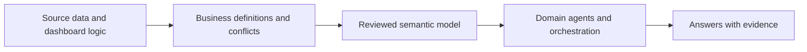

# Enterprise Data to AI

### Making fragmented enterprise data understandable and usable through AI.

Enterprise data can be large in volume and difficult to interpret. Business definitions live across dashboards, warehouse views, and domain-specific sources. An AI interface needs reliable business meaning behind its answers.

This portfolio explores the journey from scattered data and logic to semantic models and conversational experiences, drawing on patterns from Energy & Utilities.

**Status:** Architecture patterns and demonstration design. The public application is not built yet.

## Explore

| Pattern | What it covers | Status |
| --- | --- | --- |
| [Cross-domain conversational data](case-studies/databricks-enterprise-data.md) | Domain-specific data workspaces, supervisor orchestration, and a conversational UI | Architecture pattern |
| [Business logic to semantic models](case-studies/looker-semantic-layer.md) | Turning dashboard and warehouse logic into a semantic layer that agents can use | Architecture pattern |
| [Public demonstration](demo/README.md) | A fictional utility with conflicting definitions of active customers | Planned; synthetic seed data included |

## The journey

This diagram describes the public demonstration's intended journey.

## What this portfolio makes visible

- **Domain judgment:** identifying grain, filters, business exceptions, and differences between accounts and service points.
- **Semantic modelling:** making definitions explicit and tracing them to source logic.
- **Agent architecture:** choosing domain boundaries and coordinating questions across them.
- **Hands-on delivery:** building a usable interface and measuring its behaviour.

## Public demonstration scope

Start with one question: **“How many active customers do we have?”**

The proposed experience lets a visitor compare conflicting definitions, review a business definition, inspect lineage, and ask a question grounded in the approved meaning.

[Explore the scenario →](demo/README.md) · [Inspect the synthetic data →](data/README.md) · [Review the evaluation plan →](evaluation/README.md)

## About the patterns

The patterns are generalised architecture approaches, not accounts of any specific organisation. The demonstration is an independent implementation using fictional data and original assets. No client names, datasets, code, dashboard exports, or internal architecture documents are included. Platform integrations will be labelled as implemented, simulated, or planned as development progresses.

[My profile](https://github.com/Yasind24) · [LinkedIn](https://linkedin.com/in/yasin-d)
